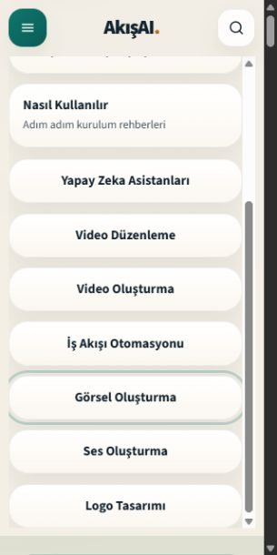
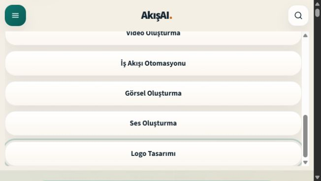
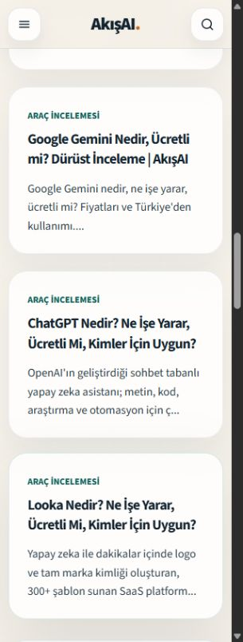

# Mobil düzeltmeler — yerel doğrulama

Kontrol tarihi: **6 Kasım 2026**. Üç uygulama dosyası değiştirildi. Üretim, canlı CMS, URL'ler, içerik alanları ve SEO yapılandırması değiştirilmedi.

## Değişiklikler

- `src/components/Header.tsx`: kapalı mobil arama ve gezinme panelleri artık `hidden` taşır. Kapalı panelin bağlantıları ve arama kutusu Tab sırasına girmez. Açma düğmelerinin mevcut `aria-expanded`/`aria-controls` ilişkileri ve tüm bağlantılar korunur.
- `src/components/header.css`: 560 px sınırı ve yalnızca görsel olarak küçültülen kapalı panel düzeni kaldırıldı. Açık panel, araç çubuğuna yer bırakan `100dvh` sınırı içinde doğal olarak kayar; `100vh` geri dönüşü vardır. `hidden` taşıyan panel, açık panelin CSS seçicisine eşleşmez. Taşan menünün son bağlantısına hem kaydırmayla hem klavyeyle erişilir.
- `src/app/yazar/[slug]/author.css`: kart ızgarasının 300 px alt sınırı dar kapsayıcıyı aşmayacak şekilde sınırlandı. Kartlar küçülebilir ve uzun metinler satıra bölünebilir. Masaüstündeki sütun düzeni korunur.

Değişikliklerin tamamı [changes.patch](changes.patch), makine tarafından okunabilir sonuçlar [verification.json](verification.json) içindedir. Yazar liste sayfası da kontrol edildi; burada aynı taşma oluşmadığı için `authors.css` değiştirilmedi.

## Tamamlanan testler

- Mevcut testler: **11/11 geçti**. `npm run typecheck` geçti. `npm run lint`: 0 hata; önceden mevcut `PortableTextContent.tsx:88` kullanılmayan değişken uyarısı sürüyor.
- Next.js 16.4.5/Turbopack üretim derlemesi geçti; 58 statik üretim girdisi tamamlandı. Önceki tam yayımlanmış içerik snapshot'ı ve uygulama dışındaki salt okunur fixture adaptörü kullanıldı. Gerçek CMS'ye yazılmadı; ayrı `prebuild` manifest betiği çalıştırılmadı.
- Sunucu yeni derlemeyle yeniden başlatıldı. Yerel HTTP kontrolünde **44/44** sayfa normal ve Googlebot kullanıcı aracısıyla 200 döndü. Kullanıcı aracına göre içerik veya SEO farkı yok. Bu, gerçek Google IP'si/URL Inspection testi değil, kullanıcı aracısı benzetimidir.
- Önceki yerel HTTP çıktısına göre 44 sayfanın title, açıklama, canonical, robots, H1, normalize ana gövde ve **127 ayrıştırılmış JSON-LD** kaydı aynı. Tüm bağlantıların sırası ve URL'leri, sitemap URL kümesi ve robots.txt korundu. 12 ek 404, yönlendirme ve noindex kontrolü aynı sonucu verdi.
- 10 sayfada 320, 360, 390 ve 768 px genişlikler: **40/40 kombinasyon geçti**. Yatay taşma, görünür kalan kapalı panel, eksik/çoğalan H1 veya canonical, görünür bozuk görsel ya da yakalanan uygulama konsol hatası yok. Tarayıcı eklentisi günlükleri uygulama hatası sayılmadı.
- Menü 320×640, 390×844 ve 667×375 boyutlarında ayrıca test edildi. 11 bağlantının sonuncusu olan **Logo Tasarımı**, Tab ile odaklanabildi, panel içinde görünür kaldı ve doğru yerel kategori URL'sini açtı. Panel yüksekliği sırasıyla 544, 748 ve 279 px; içerik yüksekliği 769 px olduğu için kalan içerik kaydırılarak erişilebilir.
- Kapalı menüden sonraki Tab sırası: ana sayfa bağlantısı → aramayı aç düğmesi → görünür ana sayfa araması. Gizli mobil arama kutusu bu sırada yok.
- Arama açma, menü/arama panellerinin birbirini kapatması ve `GET /arama?q=chatgpt` gönderimi geçti. Arama sonucunda `noindex, follow` ve mevcut canonical korundu.
- 1440 px masaüstü kontrolünde yazar kartları üç sütunda kaldı; masaüstü gezinmesi görünür ve yatay taşma yok.

İlk gezinmelerde tarayıcının eski derlemeye ait önbelleği görüldü. Nihai 40 kombinasyonun her birinde sayfa yeniden yüklenerek yeni CSS ve HTML doğrulandı. [responsive-matrix.json](responsive-matrix.json) yalnızca bu nihai sonuçları içerir. Klasik masaüstü kaydırma çubuğu nedeniyle gerçek DOM içerik genişliği istenen görünüm genişliğinden 15 px daha dardır; taşma gerçek `clientWidth` değerine göre ölçüldü. Bu kontroller Brave/Chromium görünüm emülasyonudur; fiziksel iOS/Android testi değildir.

## Ekran kanıtları

320 px görünümde menünün alt bağlantıları:

Yatay görünümde menü:

320 px görünümde yazarın içerik kartları:

Önceki dosyalar ve ayrıntılı yerel HTTP kayıtları `C:\Users\comez\AppData\Local\Temp\akisai-mobile-fixes-20261106` dizininde saklandı. Yerel test sunucusu kullanıcının başlattığı 3100 portundaki sunucudur; bu çalışma kapsamında deployment yapılmadı.
